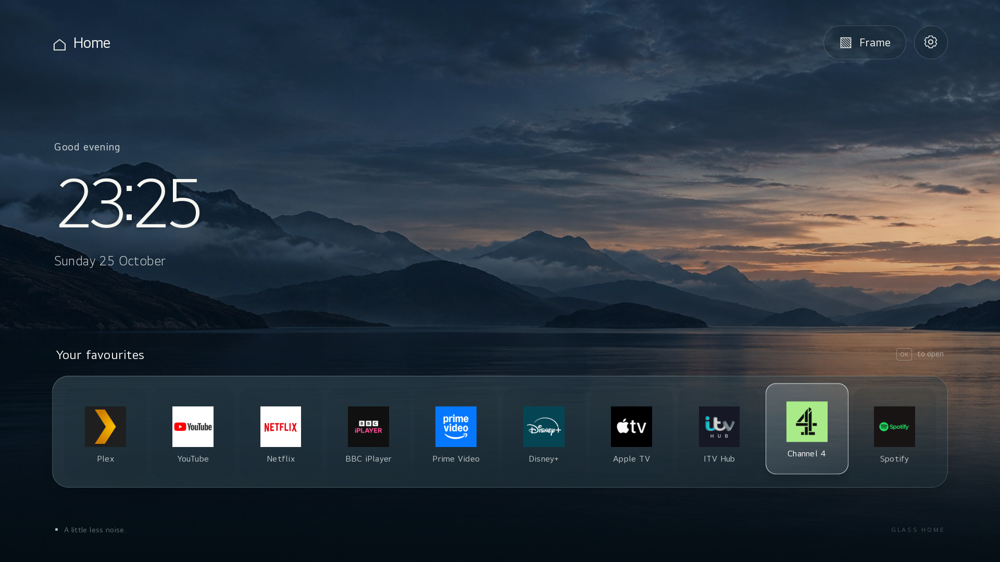

<div align="center">


# LGGlassUI

### A little less noise. A lot more home.

A quiet, glass-inspired home screen for LG webOS TVs.<br>
Your favourite apps, your photographs, and room to breathe.

[**Download the setup ZIP →**](https://github.com/PaulButtle/LGGlassUI/releases/latest)

 

[Explore the interface](#made-for-the-living-room) · [Try it locally](#try-it-locally) · [Install on your TV](docs/INSTALL.md) · [Recovery](docs/RECOVERY.md)



**No dashboard ads** &nbsp; · &nbsp; **No analytics** &nbsp; · &nbsp; **No frontend framework** &nbsp; · &nbsp; **Local-first**

</div>

## Made for the living room

Glass Home keeps the screen calm: a full-screen landscape, a legible clock and a single glass shelf of the apps you actually use. Focus is clear from the sofa, and every action works with the remote.

| A considered home | A personal frame |
| --- | --- |
| Nine native streaming-app shortcuts | Photographs stored on your TV |
| Directional remote and Magic Remote pointer | Upload from a phone or computer |
| Direct access to TV Settings | Fit or fill, brightness and slideshow speed |
| Original LG Home available for recovery | Pause, previous/next and timed sessions |
| Bundled assets; no CDN or web-font requests | LG panel protection stays enabled |

Your optional greeting follows the time of day: **Good evening, Alex and Sam**. Names stay in your private installation settings.

**The default shelf**<br>
Plex · YouTube · Netflix · BBC iPlayer · Prime Video · Disney+ · Apple TV · ITV Hub · Spotify

Change the names, order and installed app IDs in [`app/config.js`](app/config.js). The shortcuts open the TV's native apps; LGGlassUI does not proxy their content or manage streaming accounts.

**Straight home.** On the tested LG CX, Glass Home is registered as LG's native startup input. There is no extra 12-second launch timer or HDMI-first handoff. Normal HDMI viewing remains available, and the original LG Home stays accessible for recovery. The television's own power-on sequence still takes time.

> The dashboard has no advertising. Streaming services and the retained LG recovery interface still control their own content and ads.

## Small by design

The TV app is plain HTML, CSS and JavaScript, with bundled imagery and no runtime internet dependencies. The packaged dashboard is approximately **320 KB**. On the tested LG CX, JavaScript UI readiness measured approximately **0.3–0.4 seconds**; this is not a measurement of television power-on time or complete image decoding.

The companion photo service uses Node's built-in HTTP server. A separate, small privileged component handles native startup preferences and the Home button. Photos and ordinary image handling run without root privileges.

## Try it locally

Requires **Node.js 22 or newer** on your development computer. No `npm install` is needed for the preview or tests.

```sh
git clone https://github.com/PaulButtle/LGGlassUI.git
cd LGGlassUI
npm run preview
```

Open **http://127.0.0.1:4178**. Use the arrow keys, Enter and Escape, or a mouse.

The browser preview demonstrates the interface. Native app launching, TV Settings and the TV's photo collection require an installed TV build.

```sh
npm test
```

## Install on your TV

**Full Home-button and startup integration requires a rooted TV with webOSbrew.** This repository does not root your television or include a universal root exploit.

1. Download and extract **LGGlassUI-v1.3.0-setup.zip** from the [latest release](https://github.com/PaulButtle/LGGlassUI/releases/latest).
2. Open a terminal in the extracted folder and run `node setup.cjs`.
3. Enter your TV address, SSH port/key and optional greeting names.

Setup installs the dashboard and photo service, then opens Glass Home. You need **Node.js 22+**, **OpenSSH** and a working **root SSH key**. No Git, npm install or LG developer CLI required. Each installation gets its own private photo key.

Once the dashboard works on your TV, enable Home-button and startup replacement using the [installation guide](docs/INSTALL.md). Original LG Home remains available. The release includes a standalone public IPK and SHA-256 checksums too.

[Full setup & troubleshooting →](docs/INSTALL.md) &nbsp; [What's new →](CHANGELOG.md)

| Tested hardware | Runtime |
| --- | --- |
| LG CX / OLED65CX5LB | webOS SDK 5.6.2 |
| Firmware 04.64.00 | Chromium 68 |
| 1920 × 1080 app surface | TV Node.js 8.12.0 |

Other models and firmware versions are **unverified**. Native APIs, app IDs and Home key codes may differ. See [compatibility and verification](docs/COMPATIBILITY.md).

## Your photographs, on your TV

1. Open **Settings → Photo collection** in Glass Home.
2. Visit the displayed address on a phone or computer on the same network.
3. Enter the access key shown on the TV and add your photographs.
4. Choose **Frame → Start Frame**.

The uploader converts JPEG, PNG and WebP images to suitably sized JPEGs before uploading. Your collection stays on the television: up to **100 photographs / 256 MiB**, with no cloud account.

Frame supports 15-, 30- and 60-minute manual sessions. Brightness is a display overlay, and LG's existing panel-protection settings remain unchanged.

**Your photographs can be the screensaver, too.** On the supported CX firmware, choose **Settings → Screensaver → Frame Photographs**. Your uploaded collection replaces the Fireworks view with softly dimmed, gently moving images. The screensaver follows your Frame interval and fit; LG still controls idle timing and remote wake-up. Select **LG Fireworks** to restore the original view. No photographs yet? The bundled landscape is available.

This option is guarded by the tested LG screensaver fingerprint. Unsupported firmware keeps its original screensaver. See [setup and compatibility](docs/INSTALL.md#frame-photographs-as-the-screensaver).

| Remote control | Action |
| --- | --- |
| Left / right | Move between apps or photographs |
| Up | Reach Frame and Settings |
| OK | Open an app or pause/resume Frame |
| Back | Close a panel or leave Frame |
| Home | Return to Glass Home |

## Built to be recoverable

Open **Settings → Open LG Home** whenever you need the original interface. A separate SSH recovery command disables the custom integration even if the dashboard fails to load.

[Read the recovery guide →](docs/RECOVERY.md)

The photo API requires a private access key, validates and decodes uploaded JPEGs, bounds concurrent uploads, and commits collection changes atomically. It has no shell-execution endpoint. See [architecture and security boundaries](docs/ARCHITECTURE.md).

## Around the project

```text
app/                 The complete TV interface and bundled landscape
service/             Photo library API and browser upload manager
integration/         Native startup preference, Home hook and recovery
scripts/             Preview, package, provision and deployment tools
tests/               Navigation, photo API and integration regressions
docs/                Installation, compatibility, recovery and screenshots
```

Device addresses, SSH keys, household names and access tokens stay in ignored `.local/` files and on your TV. Public release packages are generic; locally built packages in `dist/private/` contain your private photo key and must not be shared. See [building a release](docs/RELEASING.md).

## Credits & licence

Built by [Paul Buttle](https://github.com/PaulButtle).

- [webOSbrew](https://www.webosbrew.org/) for the homebrew foundation.
- [LG Input Hook](https://github.com/Simon34545/lginputhook) and [inputhookpp](https://github.com/sundermann/inputhookpp) for native remote interception. The installer uses pinned, checksum-verified binaries; they are not redistributed in this repository.
- [webOSbrew custom-screensaver](https://github.com/webosbrew/custom-screensaver) for documenting the reversible QML bind-mount approach. LG firmware source is transformed only on the owner’s TV and is not distributed.
- [jpeg-js](https://github.com/jpeg-js/jpeg-js) for bounded server-side JPEG decoding. Its BSD licence is preserved alongside the vendored source.
- The bundled landscape was generated for this project.

Project code is available under the [MIT licence](LICENSE), except for separately licensed dependencies. Service names and marks belong to their respective owners. LGGlassUI is an independent project and is not affiliated with LG or the streaming services.
