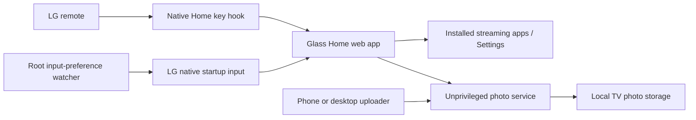

# Architecture

LGGlassUI has three deliberately separate parts.

## TV application

`app/` contains an offline HTML/CSS/JavaScript app targeting Chromium 68. It uses `PalmServiceBridge` to launch installed applications. The nine default IDs are configurable in `app/config.js`. Navigation and stored preferences are validated in `app/core.js`.

Photo access uses localhost port 18765. The Content Security Policy limits runtime connections to that local service; no remote fonts, tracking scripts, content feeds or recommendation APIs are loaded.

## Native startup and Home

The app declares `supportGIP: true` and includes a large icon, allowing LG's External Input Manager to register it as an input application. `configure-startup.js enable` saves the previous input, registers Glass Home, and sets the next-start input through LG's native `setLastInput` API.

The controller watches LG's persisted input metadata. After an HDMI selection, it restores the **next-start preference**, leaving the current foreground application untouched. There is no delayed dashboard launch and no continuous foreground enforcement. LG's own boot routing launches the app.

This behaviour was inspected and exercised on the tested CX firmware. It is not a documented cross-model compatibility promise. [Verification](COMPATIBILITY.md) separates observed results from untested cases.

The Home key uses pinned upstream `ezinject` / `inputhookpp` binaries. Only the binaries are used; their upstream network configuration server is not installed. Interception changes process memory, not LG's system partition. `home.sh` falls back to the stock launcher if the application manager rejects a launch.

## Photo service

The photo process runs as an unprivileged numeric uid/gid. It has a small, authenticated API for listing, adding, removing and ordering photos. It cannot execute shell commands or proxy arbitrary Luna calls.

- Random installation-specific access key; timing-safe comparisons.
- Origin checks for browser requests.
- 8 MiB maximum request body, two in-flight upload bodies, absolute 15-second body deadlines, 12 total connections.
- Strict JPEG decoding with a 9 MP resolution and 64 MiB decoder allocation budget.
- 100-photo / 256 MiB collection limit.
- Atomic index replacement and bounded generated filenames.
- The browser uploader converts and downscales images before transmission.

The TV service targets Node 8.12. `jpeg-js` 0.4.4 is vendored with its BSD licence. Its options object uses `Object.assign` instead of object spread for that runtime.

## Network boundary

The photo manager is HTTP on the home LAN. The access key is a capability: anyone who obtains it and can reach the TV can manage the collection. Use a trusted network; do not expose this port to the internet. Public release IPKs contain no key. Setup writes the installation key directly into the installed app on the TV after packaging. Private developer builds in `dist/private/` do include the key and must not be shared.

Administrative SSH is separate and uses pinned host verification and a private key. The controller has no network listener. Original Home and independent SSH recovery remain available.

## Local and public files

Source, tests, the generated landscape and curated documentation are public. Device-specific configuration, key material, packages, backups, diagnostic captures and firmware binaries are not part of the public repository.

## Setup and releases

The release ZIP contains a public IPK, the app/service/integration sources and a dependency-free Node setup wizard. An SHA-256 manifest detects changes before setup connects. SSH uses a pinned host key and the user’s existing private key; no password or key material is sent to GitHub. Fresh installations receive a random photo key, while updates retrieve the existing key over authenticated SSH. Home and native startup integration are opt-in on first installation.
